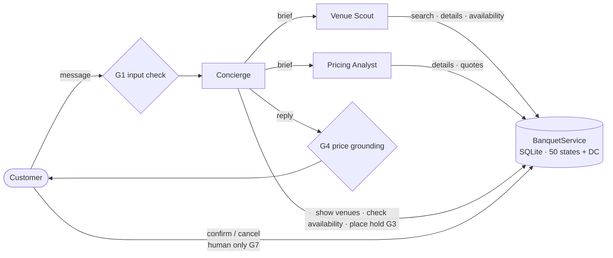

# OpenTable for Banquet Halls Using Agentic Workflows

[](https://github.com/emitby/OpenTable-for-Banquet-Halls-Using-Agentic-Workflows/actions/workflows/ci.yml)


[](LICENSE)

**Banquet Concierge** is an OpenTable-style booking app for banquet halls **in every US state and DC**. A team of cooperating AI agents built on Claude runs it. **Guardrails are enforced in code**, and a **harness** traces every call and counts the tokens used by each agent and each tool.

You describe an event in plain language, for example:

> *"Wedding for about 180 guests in Austin, Texas next October, ideally a Saturday. Budget around $45k."*

A **Concierge** agent works out what you need and sends two specialist agents to find venues, check dates and price the options. It then shows you venue cards and itemized quotes, and can place a free 72-hour hold. **Only you can confirm a booking.** No agent can commit you to a purchase.

**→ [How it works (PDF): screens, functionality map, agentic workflow, guardrails, tokens per tool](docs/how-it-works.pdf)**

[Architecture](docs/architecture.md) · [Guardrails](docs/guardrails.md) · [Harness and token accounting](docs/harness.md) · [Example session](docs/example-session.md)

---

## Contents

- [How the agents work](#how-the-agents-work)
- [Design principles](#design-principles)
- [Guardrails](#guardrails)
- [Harness](#harness)
- [Features](#features)
- [Quick start](#quick-start)
- [API](#api)
- [Testing](#testing)
- [Project layout](#project-layout)
- [Limitations and roadmap](#limitations-and-roadmap)

## How the agents work



| Agent | Role | Tools | Effort |
|---|---|---|---|
| **Concierge** | Talks to the customer, gathers requirements, delegates, presents options, places holds | `ask_venue_scout`, `ask_pricing_analyst`, `check_availability`, `show_venues`, `place_hold` | medium |
| **Venue Scout** | Searches venues by state and city, reads details, checks availability, returns a shortlist | `search_venues`, `get_venue_details`, `check_availability` | low |
| **Pricing Analyst** | Builds itemized quotes, compares options against the budget, finds savings | `get_venue_details`, `build_quote` | low |

**A typical turn:**
1. The Concierge sends the Scout a brief.
2. The Scout searches and checks availability in its own context, then returns a shortlist.
3. The Concierge shows venue cards and asks the Pricing Analyst to quote the shortlisted options.
4. The Concierge replies with a recommendation.

[docs/architecture.md](docs/architecture.md) has the sequence diagram and details of the agent loop.

## Design principles

- **Agents as tools.** Specialists are tools the Concierge calls.
  - Each brief starts a fresh context, so the venue records a specialist reads never pile up in the customer conversation.
  - When the Concierge needs both specialists, it calls them in the same turn and they run in parallel.
- **Least privilege.** Specialists can only read data. Only the Concierge can write, and only to place a non-binding hold. Confirming and cancelling are API endpoints the customer calls; no agent has those tools.
- **Facts come from code, not the model.** Every venue, price and date comes from a tool. The pricing rules live in plain Python in [`services.py`](banquet/services.py). G4 checks every price in a reply against the tool results.
- **Errors are feedback.** Bad tool arguments (G2) and booking-rule violations go back to the model as `is_error` tool results, so it can correct itself.
- **Append-only history.** The agent loop only ever appends to the conversation, which keeps prompt caching effective.
- **Safe failure.** Policy refusals get a polite reply and server-side model fallbacks are enabled. Every agent has a turn limit, and all agents share a token budget.

## Guardrails

Every guardrail is enforced in code ([`banquet/guardrails.py`](banquet/guardrails.py)). Each one is tested in both directions: the bad case is blocked, and the harmless look-alike still works. Details are in [docs/guardrails.md](docs/guardrails.md).

| # | Guardrail | What it does |
|---|---|---|
| G1 | Customer input | Strips control characters, limits length, and refuses prompt-injection phrasing **before any model call** |
| G2 | Tool arguments | Checks every tool call against its JSON schema before it runs; problems go back to the agent as fixable errors |
| G3 | Holds | Allows at most 3 active holds per conversation (also when requested in parallel), and requires exactly an email the customer typed |
| G4 | Price grounding | Every dollar amount in the Concierge's reply must match a dollar amount from a tool result or the customer. Otherwise the reply is sent back once, then flagged |
| G5 | Privacy | Emails are redacted in traces and run reports |
| G6 | Token budgets | 400K tokens per turn and 2M per conversation, checked before every model call |
| G7 | Human-only commitments | No agent can confirm or cancel; only the customer can |

## Harness

[`banquet/harness/`](banquet/harness) wraps the agent team without changing it ([docs/harness.md](docs/harness.md)):

- **Trace.** The runtime emits an event for every model call (usage, latency, tools requested) and every tool call (ok or error, latency, result size). Each run is written to `runs/<id>/`, with emails redacted.
- **Token ledger.** Usage per agent is exact. Usage is also attributed to **each tool** in three parts:
  - *decision* tokens: the cost of calling it
  - *result* tokens: the cost of reading its output
  - *specialist* tokens: a delegated agent's whole run
- **Scenarios.** Six scripted conversations, checked by eight scorers:
  - a Texas wedding with a hold
  - an Ohio corporate dinner
  - a NYC gala on a booked date
  - a price guess caught by G4
  - a hold without an email, caught by G3
  - an off-topic request and an injection attempt, caught by G1
- **Modes.**
  - `simulated`: a scripted stand-in for Claude that drives the real tools. Free and offline; token counts are estimates.
  - `live`: real agents and real usage, with a cost cap checked between scenarios. G3 and G4 may fire but aren't required, since real agents rarely invent prices or emails on cue.

```powershell
.\run.ps1 scenarios                       # simulated
.\run.ps1 scenarios --live --max-cost 5   # real Claude agents, stops past $5
```

## Features

- **Natural-language search** by guest count, state, city, style, cuisine, dietary needs, amenities, budget and date.
- **Search in any state.** There are 214 **fictional** venues: the original 10 around New York City, plus four in every state and DC. `state` accepts a name or a code ("Texas" or "TX").
- **Real availability.** Each hall takes one event per day, and active holds block the date. When a date is taken, the nearest open dates are suggested.
- **Itemized quotes:**
  - rental
  - Friday/Saturday premium (+25%) and peak-season premium (+15%)
  - food and beverage, with guest minimums
  - 20% service charge
  - the venue's sales tax (approximate state base rates; the original NYC-area venues use combined local rates)
  - the 25% deposit
- **72-hour holds** that expire on their own; the customer then confirms or releases them.
- **Web chat UI** with venue cards, a holds panel, and an **Agent activity** list (steps, guardrails and tokens) under each reply.
- **Terminal CLI** with an optional `--verbose` trace.

## Quick start

Requires **Python 3.10+**. Live agents need an [Anthropic API key](https://console.anthropic.com/); simulated mode doesn't.

```powershell
git clone https://github.com/emitby/OpenTable-for-Banquet-Halls-Using-Agentic-Workflows.git
cd OpenTable-for-Banquet-Halls-Using-Agentic-Workflows

python -m venv .venv
.venv\Scripts\python.exe -m pip install --no-cache-dir -r requirements.txt
$env:ANTHROPIC_API_KEY = "sk-ant-..."       # macOS/Linux: export ANTHROPIC_API_KEY=sk-ant-...
```

Always start the app with the launcher: `run.ps1` on Windows, `run.sh` on macOS and Linux. It keeps Python's cache, the Playwright browser and temporary files inside the project folder.

| Command | What it does |
|---|---|
| `.\run.ps1 serve` | Web app on <http://127.0.0.1:8000> with live agents |
| `.\run.ps1 serve --simulated` | Web app with the scripted stand-in: no API key, no cost |
| `.\run.ps1 cli --verbose` | Terminal chat showing agent activity, guardrails and tokens. Commands: `/holds`, `/confirm <id>` (after a y/N prompt), `/quit` |
| `.\run.ps1 test` | Offline test suite |
| `.\run.ps1 scenarios [--live --max-cost 5]` | Harness scenarios and the token ledger |
| `.\run.ps1 install-browser`, then `.\run.ps1 guide` | Screenshots and `docs/how-it-works.pdf` (needs `pip install playwright`) |

The SQLite database is created and seeded at `data/banquet-v2.db` on first run. To start fresh, point `--db` at a new file, for example `.\run.ps1 serve --db data\fresh.db`. Files are never deleted. `uvicorn banquet.api:app` also works, with the default database.

## API

| Method | Path | Purpose |
|---|---|---|
| `POST` | `/api/chat` | `{message, session_id?}` → `{session_id, reply, venues, holds, events, guardrails}` |
| `GET` | `/api/venues` | Browse venues (filters: `guest_count`, `state`, `city`, `style`, `cuisine`) |
| `GET` | `/api/venues/{id}` | Venue details |
| `GET` | `/api/sessions/{id}/holds` | Holds placed in a chat session |
| `POST` | `/api/bookings/{id}/confirm` | `{email}`. The customer confirms a hold |
| `POST` | `/api/bookings/{id}/cancel` | `{email}`. The customer cancels or releases |

Every response carries security headers: a CSP, `nosniff`, `X-Frame-Options: DENY` and `Referrer-Policy: no-referrer`. While the server is running, interactive OpenAPI docs are at `/docs`.

## Testing

```powershell
.\run.ps1 test
```

The 171 tests make **no API calls**, and they write nothing outside the project: they use in-memory databases and `.cache/test-output/`. Agent tests use a scripted fake client.

| Area | Covered |
|---|---|
| Booking rules | Search filters, guest minimums, dietary matching, date-aware search, pricing math, cross-venue package rejection, capacity limits |
| Holds | Conflicts, expiry, confirmation, ownership checks, cancellation, date validation |
| States | Every state and DC has venues; names and codes; unknown states; combined filters; per-state tax |
| Guardrails | G1–G7, each blocked case and its benign look-alike |
| Agent loop | Tool execution, parallel tool calls, schema errors, unknown tools, refusals, turn limits, token budget |
| Agent team | Delegation with a fresh context, venue cards, holds, no confirm/cancel tools, injections never reaching a model, hold limits, price grounding |
| Harness | Token attribution math (including combined scenarios), all six scenarios passing all eight scorers, scorers failing on a broken transcript, redacted and confined traces |
| API | Security headers, browsing by state, chat → hold → human confirmation, message limits |
| CLAUDE.md | No `os`, no deletion calls, a docstring on every module, class and function, path confinement, a loopback-only server |

CI runs the suite on Python 3.10 to 3.12 for every push and pull request.

## Project layout

```
banquet/
├── agents/
│   ├── runtime.py        Agent loop on the Claude Messages API; events, G2 and G6 hooks
│   └── team.py           Concierge, Venue Scout, Pricing Analyst; prompts, tools, G1/G3/G4
├── harness/
│   ├── trace.py          Run folders and redacted trace.jsonl / JSON reports
│   ├── tokens.py         Token and cost ledger per agent and per tool
│   ├── scenarios.py      Six scripted customer scenarios and eight scorers
│   ├── simulated.py      SimulatedClient: scripted stand-in for Claude
│   └── run_scenarios.py  Runs the suite (simulated or live) and writes runs/<id>/
├── guardrails.py         G1–G7
├── services.py           Booking rules: search, availability, quotes, holds
├── states.py             States, sample cities, approximate sales-tax rates
├── db.py                 SQLite schema and fictional seed data for every state
├── paths.py              Path confinement and atomic writes (no os, no deletions)
├── api.py, serve.py      FastAPI app and the 127.0.0.1 server entry point
├── cli.py                Terminal chat
├── guide.py              Builds docs/how-it-works.pdf
└── static/index.html     Web UI (vanilla JS, no build step)
docs/
├── how-it-works.pdf      Illustrated guide (generated)
├── architecture.md       Design, sequence diagram, agent loop
├── guardrails.md         Each guardrail: where it's enforced, its tests and its limits
├── harness.md            Events, trace, token attribution, scenarios, scorers
└── example-session.md    A real conversation from a live run (before the nationwide update)
tests/                    pytest suite
tasks/                    todo.md (plan and review) and lessons.md
run.ps1, run.sh           Launchers
```

## Model configuration

All agents use **`claude-opus-5-5`** with adaptive thinking. The Concierge runs at `medium` effort and the specialists at `low`, since their tasks are narrow and well specified. Server-side refusal fallbacks are enabled with `fallbacks="default"`. These settings are in [`runtime.py`](banquet/agents/runtime.py) and [`team.py`](banquet/agents/team.py). Token prices for cost estimates are in [`harness/tokens.py`](banquet/harness/tokens.py).

## Limitations and roadmap

This is a prototype:

- Chat sessions live in memory, so restarting the server clears conversations. Bookings persist in SQLite.
- There are no payments or user accounts. Confirmation is checked by email match only.
- Venue data is fictional. Sales tax uses approximate state base rates; local and meals taxes aren't modeled.
- The injection check (G1) catches known phrasings. The agents' instructions are the second line of defense.
- Token numbers in the PDF come from the simulated mode and are estimates. Run the live mode for real usage.

Ideas for next steps:

- [ ] A **Venue Manager** agent that answers venue-specific questions and accepts or declines requests
- [ ] Streaming replies and live agent activity in the UI
- [ ] Persistent sessions and customer accounts
- [ ] Calendar export (.ics) for confirmed bookings
- [x] An evaluation suite that scores recommendations against scripted customer scenarios (the harness)

## License

[MIT](LICENSE) © 2026 Edward Mitby
