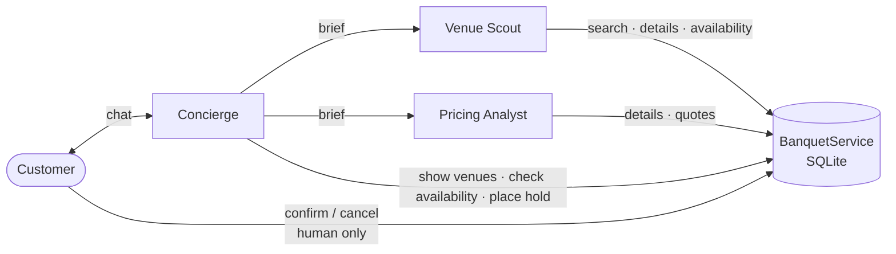

# OpenTable for Banquet Halls Using Agentic Workflows

[](https://github.com/emitby/OpenTable-for-Banquet-Halls-Using-Agentic-Workflows/actions/workflows/ci.yml)


[](LICENSE)

**Banquet Concierge** is an OpenTable-style booking app for banquet halls, run by a team of cooperating AI agents built on Claude.

You describe an event in plain language, for example:

> *"Wedding for about 250 guests in Queens next June, ideally a Saturday. Indian food with halal options, budget around $60k."*

A **Concierge** agent works out what you need and sends two specialist agents to find venues, check dates and price the options. It then shows you venue cards and itemized quotes, and can place a free 72-hour hold. **Only you can confirm a booking.** No agent can commit you to a purchase.

→ [Example session](docs/example-session.md) · [Architecture](docs/architecture.md)

---

## Contents

- [How the agents work](#how-the-agents-work)
- [Design principles](#design-principles)
- [Features](#features)
- [Quick start](#quick-start)
- [API](#api)
- [Testing](#testing)
- [Project layout](#project-layout)
- [Limitations and roadmap](#limitations-and-roadmap)

## How the agents work



| Agent | Role | Tools | Effort |
|---|---|---|---|
| **Concierge** | Talks to the customer, gathers requirements, delegates, presents options, places holds | `ask_venue_scout`, `ask_pricing_analyst`, `check_availability`, `show_venues`, `place_hold` | medium |
| **Venue Scout** | Searches venues, reads details, checks availability, returns a shortlist | `search_venues`, `get_venue_details`, `check_availability` | low |
| **Pricing Analyst** | Builds itemized quotes, compares options against the budget, finds savings | `get_venue_details`, `build_quote` | low |

A typical turn: the Concierge sends the Scout a brief. The Scout runs a dozen searches and availability checks in its own context and returns a shortlist. The Concierge shows venue cards, asks the Pricing Analyst to quote the shortlisted options, and replies with a recommendation. See [docs/architecture.md](docs/architecture.md) for the sequence diagram and agent-loop details.

## Design principles

- **Agents as tools.** Specialists are tools the Concierge calls. Each brief starts a fresh context, so the venue records a specialist reads never pile up in the customer conversation. When the Concierge needs both specialists, it calls them in the same turn and they run in parallel.
- **Least privilege.** Specialists can only read data. Only the Concierge can write, and only to place a non-binding hold. Confirming and cancelling are API endpoints the customer calls; no agent has those tools.
- **Facts come from code, not the model.** Every venue, price and date comes from a tool. The pricing rules (premiums, minimums, service charge, tax, deposit) live in plain Python in [`services.py`](banquet/services.py), and the prompts forbid estimating.
- **Errors are feedback.** Bad tool arguments and booking-rule violations go back to the model as `is_error` tool results so it can correct itself. In the live test, the Scout recovered from a failed search on its own.
- **Append-only history.** The agent loop only ever appends to the conversation, which keeps prompt caching effective.
- **Safe failure.** Policy refusals get a polite reply, server-side model fallbacks are enabled, and every agent has a turn limit.

## Features

- Natural-language search by guest count, area, style, cuisine, dietary needs, amenities, budget and date
- Real availability: one event per hall per day, with active holds blocking the date and the nearest open dates suggested when a date is taken
- Itemized quotes: rental, Friday/Saturday premium (+25%), peak-season premium (+15%), food & beverage with guest minimums, 20% service charge, NYC sales tax (8.875%), and the 25% deposit
- 72-hour holds that expire on their own, then human confirmation or release
- Web chat UI with venue cards, a holds panel and an **Agent activity** trace under each reply
- Terminal CLI with an optional `--verbose` agent trace
- 10 **fictional** venues across Manhattan, Brooklyn, Queens, the Bronx, Long Island and New Jersey

## Quick start

Requires **Python 3.10+** and an [Anthropic API key](https://console.anthropic.com/).

```bash
git clone https://github.com/emitby/OpenTable-for-Banquet-Halls-Using-Agentic-Workflows.git
cd OpenTable-for-Banquet-Halls-Using-Agentic-Workflows

python -m venv .venv
.venv\Scripts\activate            # macOS/Linux: source .venv/bin/activate
pip install -r requirements.txt

set ANTHROPIC_API_KEY=sk-ant-...  # macOS/Linux: export ANTHROPIC_API_KEY=sk-ant-...
```

**Web app**

```bash
uvicorn banquet.api:app --reload
```

Open <http://127.0.0.1:8000> and try one of the suggested prompts.

**Terminal**

```bash
python -m banquet.cli --verbose
```

CLI commands: `/holds` lists your holds, `/confirm <id>` confirms one (after a y/N prompt), and `/quit` exits.

The SQLite database is created and seeded at `data/banquet.db` on first run. Delete the file to reset it. Set `BANQUET_DB` to use a different path.

## API

| Method | Path | Purpose |
|---|---|---|
| `POST` | `/api/chat` | `{message, session_id?}` → `{session_id, reply, venues, holds, events}` |
| `GET` | `/api/venues` | Browse venues (`guest_count`, `city`, `style`, `cuisine` filters) |
| `GET` | `/api/venues/{id}` | Venue details |
| `GET` | `/api/sessions/{id}/holds` | Holds placed in a chat session |
| `POST` | `/api/bookings/{id}/confirm` | `{email}`. Customer confirms a hold |
| `POST` | `/api/bookings/{id}/cancel` | `{email}`. Customer cancels or releases |

Interactive OpenAPI docs are at `/docs` while the server is running.

## Testing

```bash
pytest
```

The 20 tests make **no API calls**. Agent tests use a scripted fake client.

| Area | Covered |
|---|---|
| Booking rules | Search filters, guest minimums, dietary matching, date-aware search, pricing math, cross-venue package rejection, capacity limits |
| Holds | Conflicts, expiry, confirmation, ownership checks, cancellation, date validation |
| Agent loop | Tool execution, parallel tool calls in one message, bad-argument recovery, unknown tools, refusals, turn limits |
| Agent team | Concierge → Scout delegation with a fresh context, venue cards, hold placement, specialists having no write tools |

CI runs the suite on Python 3.10 to 3.12 for every push and pull request.

## Project layout

```
banquet/
├── agents/
│   ├── runtime.py     Agent loop on the Claude Messages API
│   └── team.py        Concierge, Venue Scout, Pricing Analyst, their prompts and tools
├── services.py        Booking rules: search, availability, quotes, holds
├── db.py              SQLite schema and fictional seed data
├── api.py             FastAPI app
├── cli.py             Terminal chat
└── static/index.html  Web UI (vanilla JS, no build step)
docs/
├── architecture.md    Design, sequence diagram, agent loop
└── example-session.md A real conversation from a live run
tests/                 pytest suite
```

## Model configuration

All agents use **`claude-opus-5-5`** with adaptive thinking. The Concierge runs at `medium` effort and the specialists at `low`, since their tasks are narrow and well specified. Server-side refusal fallbacks are enabled with `fallbacks="default"`. You can change these settings in [`runtime.py`](banquet/agents/runtime.py) and [`team.py`](banquet/agents/team.py).

## Limitations and roadmap

This is a prototype:

- Chat sessions live in memory, so restarting the server clears conversations. Bookings persist in SQLite.
- There are no payments or user accounts. Confirmation is checked by email match only.
- Venue data is fictional.

Ideas for next steps:

- [ ] A **Venue Manager** agent that answers venue-specific questions and accepts or declines requests
- [ ] Streaming replies and live agent activity in the UI
- [ ] Persistent sessions and customer accounts
- [ ] Calendar export (.ics) for confirmed bookings
- [ ] An evaluation suite scoring recommendations against scripted customer scenarios

## License

[MIT](LICENSE) © 2026 Edward Mitby
