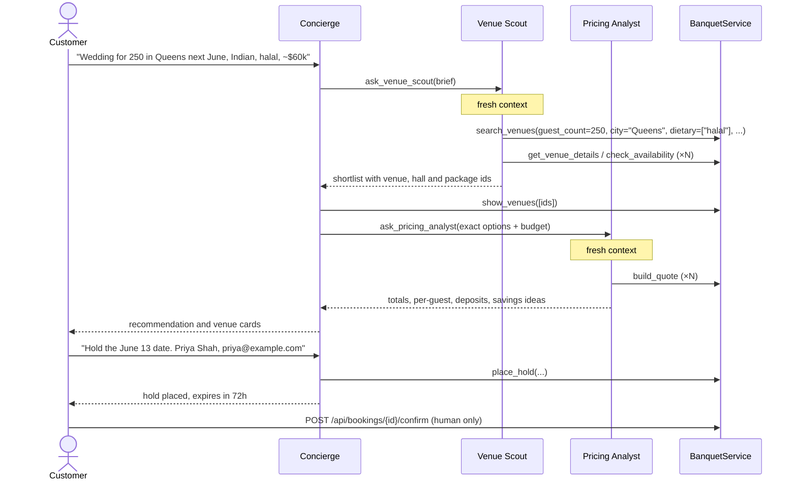

# Architecture

## Layers

| Layer | File | Knows about |
|---|---|---|
| Storage | [`banquet/db.py`](../banquet/db.py) | SQLite schema, seed data |
| Domain | [`banquet/services.py`](../banquet/services.py) | Search, availability, pricing, holds. **No AI.** |
| Agent runtime | [`banquet/agents/runtime.py`](../banquet/agents/runtime.py) | The Claude tool-use loop. **No booking logic.** |
| Agent team | [`banquet/agents/team.py`](../banquet/agents/team.py) | Prompts, tool wiring, delegation, session state |
| Interfaces | [`banquet/api.py`](../banquet/api.py), [`banquet/cli.py`](../banquet/cli.py), [`static/index.html`](../banquet/static/index.html) | HTTP, terminal, browser |

The domain layer is plain, deterministic Python. Both the agents (through tools) and the API (for human-only actions) use it, and it has its own tests. The model chooses *which* operations to run, and the code decides *what they return*.

## A customer turn



## The agent loop

`Agent.run(messages)` in [`runtime.py`](../banquet/agents/runtime.py):

1. Call `client.beta.messages.create` with the agent's system prompt, tools, `output_config.effort`, prompt caching and server-side fallbacks.
2. Append the assistant's full `content` to the history, including thinking and tool-use blocks. The history is never edited.
3. On `refusal`, return a safe reply. If there are no tool calls, return the text.
4. Otherwise run every `tool_use` block, concurrently when there are several, and append **all** results in **one** user message.
   - Arguments are checked against the handler's signature before it runs.
   - `BookingError` and invalid arguments become `is_error: true` results the model can act on.
   - Unexpected exceptions are logged and returned as a generic error.
5. Repeat, up to `max_turns`, then raise `AgentError`.

## Delegation

A specialist is a `Tool` whose handler runs another `Agent` on a single-message conversation:

```python
Tool("ask_venue_scout", ..., lambda brief: self._delegate(self.scout, brief))
```

Benefits:

- **Context isolation.** The Scout may read a dozen venue records. The Concierge receives only the shortlist.
- **Cost control.** Specialists run at `low` effort because their tasks are narrow.
- **Parallelism.** Two delegations in one Concierge turn run at the same time.
- **Traceability.** Every agent emits `tool_call` and `tool_result` events into the turn's trace, which the UI shows as *Agent activity*.

## Safety boundaries

| Action | Who can do it |
|---|---|
| Read venues, availability, quotes | All agents |
| Place a 72-hour hold | Concierge only, after the customer asks and gives a name and email |
| Confirm or cancel a booking | The customer only, through the API or UI. No agent has these tools |

Holds are non-binding and expire on their own. An expired hold no longer blocks the date and can't be confirmed.

## Pricing rules

Defined as constants at the top of [`services.py`](../banquet/services.py):

| Rule | Value |
|---|---|
| Friday/Saturday rental premium | +25% |
| Peak months (May, Jun, Sep, Oct, Dec) rental premium | +15% |
| Food & beverage | per-guest price × max(guests, hall minimum) |
| Service charge | 20% of food & beverage |
| Sales tax | 8.875% of subtotal |
| Deposit on confirmation | 25% of total |
| Hold duration | 72 hours |
| Booking window | up to 2 years ahead |
